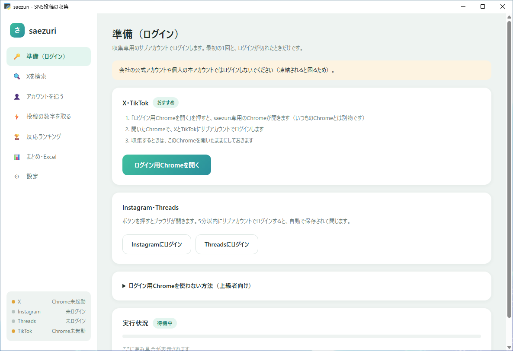
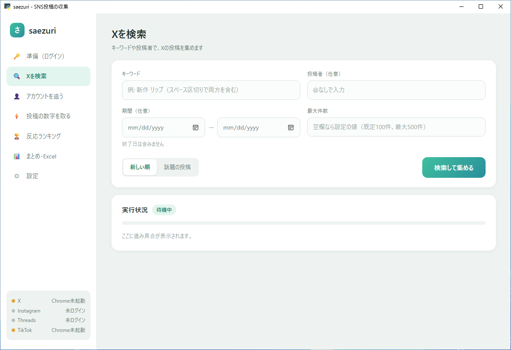
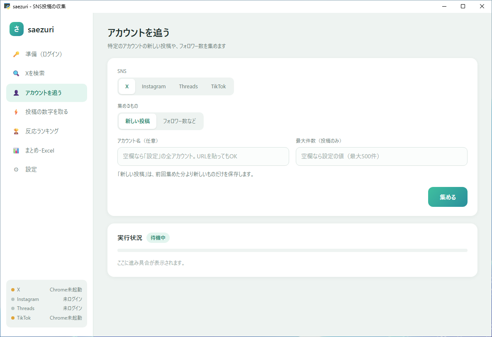
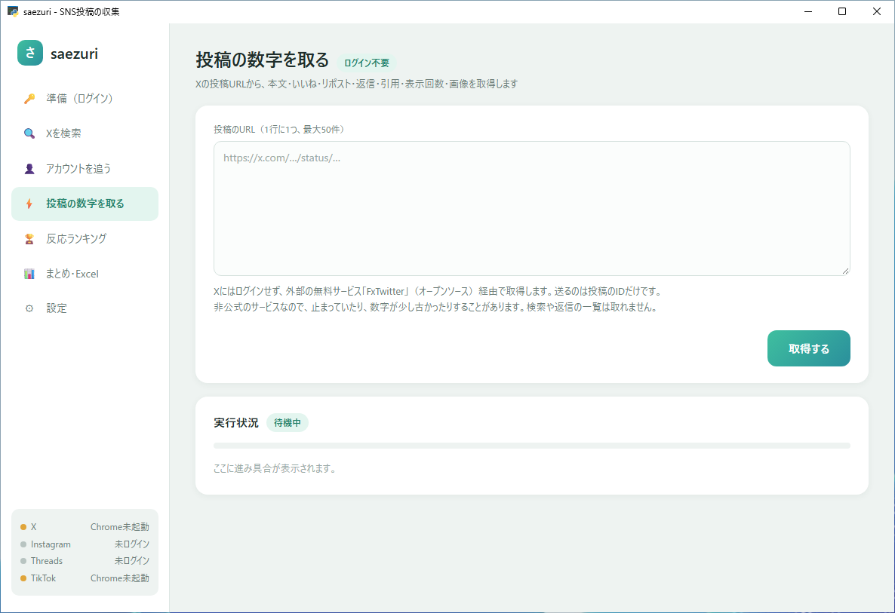
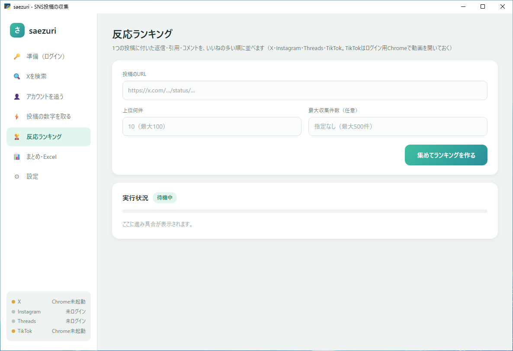
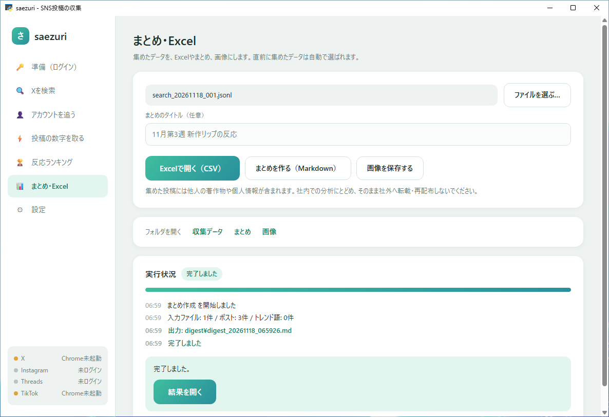
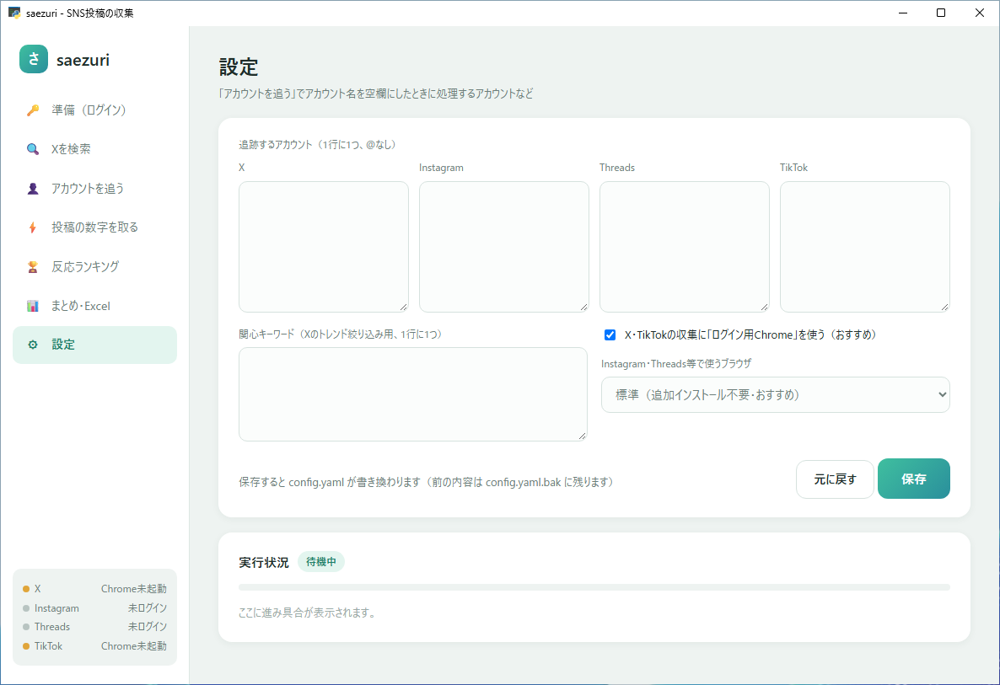

# saezuri はじめてガイド（Windows・SNS担当者向け）

コマンドを打たずに、画面のボタンだけで X・Instagram・Threads・TikTok の投稿を集めて、Excel で見られるようにするまでの手順です。パソコンに詳しくない方でも、上から順に進めれば使えるように書いています。

- 最初の準備（1〜6）は1回だけです。30分ほど見てください（ダウンロードの待ち時間を含みます）。
- 2回目からは「[7. 画面を開く](#7-画面を開く)」からで大丈夫です。
- 困ったときは「[困ったとき](#困ったとき)」を見てください。

## 目次

- [始める前に（必ず読んでください）](#始める前に必ず読んでください)
- [1. 用意するもの](#1-用意するもの)
- [2. Python を入れる](#2-python-を入れる)
- [3. Google Chrome を入れる](#3-google-chrome-を入れる)
- [4. saezuri をダウンロードする](#4-saezuri-をダウンロードする)
- [5. セットアップする（setup.bat）](#5-セットアップするsetupbat)
- [6. サブアカウントでログインする](#6-サブアカウントでログインする)
- [7. 画面を開く](#7-画面を開く)
- [8. それぞれの機能の使い方](#8-それぞれの機能の使い方)
- [9. 集めたデータを Excel で見る](#9-集めたデータを-excel-で見る)
- [10. 設定](#10-設定)
- [困ったとき](#困ったとき)
- [新しい版に入れ替えるとき](#新しい版に入れ替えるとき)

## 始める前に（必ず読んでください）

- **会社の公式アカウントや、あなた個人のアカウントではログインしないでください。** 収集専用に作った「サブアカウント」を使います。SNS側に自動の操作だと判断されると、アカウントが凍結（使えなくなる）されることがあるためです。
- **集めるのは必要なときだけ、1日に数回までにしてください。** 何度も続けて実行すると止められやすくなります。途中で「アクセスが多すぎる」「確認画面が出た」と表示されて止まったら、その日はもう実行しないでください。
- 集めたデータには、他の人の投稿や個人情報が含まれます。**社内での分析にとどめ、そのまま社外に出したり、資料にまるごと貼り付けたりしないでください。**
- 仕事で使ってよいか（各SNSの利用規約、社内の規程、個人情報の扱い）は、事前に上長や担当部署と確認してください。詳しくは [README の免責事項](../README.md#免責事項) にあります。

## 1. 用意するもの

| もの | 説明 |
| --- | --- |
| Windows 10 または 11 のパソコン | 会社のパソコンで、ソフトのインストールが制限されている場合は、情報システム担当の方に相談してください（Python と Google Chrome を入れます）。 |
| インターネット | 最初のセットアップで 300MB ほどダウンロードします。 |
| 収集専用のサブアカウント | 使うSNSの分だけ（X・TikTok・Instagram・Threads）。メールアドレスとパスワードでログインできるようにしておきます（「Googleでログイン」は使えないことがあります）。 |

## 2. Python を入れる

saezuri を動かすための部品です。すでに入っている場合も、**3.14** を入れておくと確実です（他の版と並べて入れられます）。

1. 次のリンクを開くと、インストーラーのダウンロードが始まります。
   [Python 3.14 のインストーラー（64ビット版）](https://www.python.org/ftp/python/3.14.10/python-3.14.10-amd64.exe)
   （リンクが開けないときは [python.org の Windows 用のページ](https://www.python.org/downloads/windows/) で「Python 3.14.〇〇」の「Download Windows installer (64-bit)」を押します）
2. ダウンロードした `python-3.14.10-amd64.exe` をダブルクリックします。
3. 最初の画面の下にある **「Add python.exe to PATH」にチェックを入れて**、「Install Now」を押します。
4. 「Setup was successful」と出たら「Close」で閉じます。

> **3.15 は使えません。** python.org のトップページの大きなボタンからは最新の 3.15 が入りますが、saezuri が使う部品の一部がまだ 3.15 に対応していません。3.15 だけが入っている場合、セットアップの途中で「3.14 を入れてください」と表示されます。

## 3. Google Chrome を入れる

X と TikTok には、saezuri 専用の Chrome からログインします。Chrome が入っていない場合は [Google Chrome のページ](https://www.google.com/chrome/) から入れてください。ふだん別のブラウザ（Edge など）を使っていても、Chrome を入れるだけで構いません（いつも使うブラウザを変える必要はありません）。

## 4. saezuri をダウンロードする

1. [saezuri のページ](https://github.com/Nunifuchisaka/Saezuri) を開き、緑の「**Code**」ボタン →「**Download ZIP**」を押します。`Saezuri-main.zip` がダウンロードされます。
2. **ZIPを開く前に**、ダウンロードした `Saezuri-main.zip` を右クリック →「プロパティ」を開き、下の方の「**許可する**」にチェックを入れて「OK」を押します（項目が無ければそのまま次へ）。
   これをしておくと、次の手順で「WindowsによってPCが保護されました」などの警告が出にくくなります。
3. `Saezuri-main.zip` を右クリック →「**すべて展開**」→ 展開先を選んで「展開」を押します。
   - 展開先は「ドキュメント」の中など、分かりやすい場所にします（例: `C:\Users\あなたの名前\Documents\Saezuri-main`）。
   - **OneDrive と同期しているフォルダ（デスクトップがOneDriveになっている場合を含む）は避けてください。** ログイン情報やたくさんの小さなファイルを作るので、同期でエラーになったり遅くなったりします。
   - ZIPをダブルクリックして中を見ただけの状態（展開していない状態）では動きません。必ず「すべて展開」してください。

展開したフォルダの中は、次のようになっています。

```
Saezuri-main
├─ setup.bat        ← 最初の1回だけダブルクリック
├─ start_gui.bat    ← 使うたびにダブルクリック
├─ config.example.yaml
├─ README.md
├─ docs
└─ scripts
```

## 5. セットアップする（setup.bat）

1. 展開したフォルダの **`setup.bat`** をダブルクリックします。黒い画面（コマンドプロンプト）が開いて、自動で進みます。
2. 次のどちらかの警告が出た場合は、そのまま実行してください（インターネットから落としたファイルにWindowsが出す確認で、最初の1回だけです）。
   - 「WindowsによってPCが保護されました」→「**詳細情報**」→「**実行**」
   - 「発行元を確認できませんでした。このソフトウェアを実行しますか?」→「**実行**」
3. 5〜10分ほどかかります。途中で何度か止まって見えることがありますが、そのまま待ってください。
4. 次のように表示されたら完了です。何かキーを押すと画面が閉じます。

```
[1/3] 作業用の環境を作っています（Python 3.14）...
[2/3] 必要な部品をインストールしています（数分かかります）...
[3/3] 収集用のブラウザをインストールしています（数分かかります）...

セットアップが終わりました。start_gui.bat をダブルクリックすると画面が開きます。
```

うまくいかないときは「[困ったとき](#困ったとき)」の「セットアップ」を見てください。

## 6. サブアカウントでログインする

まず画面を開きます（[7. 画面を開く](#7-画面を開く)と同じ操作です）。フォルダの **`start_gui.bat`** をダブルクリックすると、saezuri の画面が開きます。左のメニューの「**準備（ログイン）**」を押します。



### X・TikTok

1. 「**ログイン用Chromeを開く**」を押します。saezuri 専用の Chrome が開き、X と TikTok のログイン画面が出ます。
   - いつもの Chrome とは別物です（ブックマークや履歴は空っぽです）。いつもの Chrome を開いていても構いません。
2. 開いた Chrome で、**X と TikTok にサブアカウントでログイン**します。
3. ログインできたら、その Chrome は**開いたままに**しておきます。X や TikTok の収集は、この Chrome を通して行います。

この専用 Chrome は、saezuri の収集のためだけに使ってください。ふだんのネット閲覧や、他のサービス（メール、社内システムなど）へのログインには使わないでください（他のプログラムから操作できる状態で開いているためです）。使い終わったら閉じて構いません。次に収集するときに、もう一度「ログイン用Chromeを開く」を押せば、ログインしたままの状態で開きます。

画面の左下に、ログインの状況が出ます。

| 表示 | 意味 |
| --- | --- |
| ログイン用Chrome（緑） | 専用 Chrome が開いています。X・TikTokの収集ができます。 |
| Chrome未起動（黄） | 専用 Chrome が閉じています。「ログイン用Chromeを開く」を押してください。 |
| ログイン済み（緑） | Instagram・Threads にログインした記録があります。 |
| 未ログイン（灰） | まだログインしていません。 |

左下の表示は、クリックすると最新の状態に更新されます。

### Instagram・Threads

1. 「**Instagramにログイン**」（または「Threadsにログイン」）を押します。収集用のブラウザが別に開きます。
2. **5分以内に**、開いたブラウザでサブアカウントでログインします。
3. ログインできると自動で保存され、ブラウザが閉じます。画面下の「実行状況」に「完了しました」と出れば成功です。

ログインは最初の1回と、ログインが切れたときだけです。

## 7. 画面を開く

2回目からは、フォルダの **`start_gui.bat`** をダブルクリックするだけです。

- 毎回フォルダを開くのが面倒なら、`start_gui.bat` を右クリック →（Windows 11 は「その他のオプションを確認」→）「送る」→「デスクトップ (ショートカットを作成)」で、デスクトップから開けるようにできます。
- X・TikTok を集めるときは、先に「準備（ログイン）」で「ログイン用Chromeを開く」を押しておきます。
- 画面の下の「**実行状況**」に、進み具合と結果が出ます。同時に実行できるのは1つだけです。

## 8. それぞれの機能の使い方

### Xを検索

キーワードや投稿者で、Xの投稿を集めます。



- **キーワード**：スペースで区切ると「両方を含む」投稿になります（例: `新作 リップ`）。
- **投稿者**：特定のアカウントの投稿だけにしたいときに、`@` なしで入れます。
- **期間**：終了日の当日は含みません（11月1日〜11月7日を集めたいときは、終了日を11月8日にします）。
- **並び順**：「新しい順」か「話題の投稿」を選びます。
- **最大件数**：空欄なら100件です。画面からは500件までです。

### アカウントを追う

特定のアカウントの新しい投稿や、フォロワー数を集めます。



- SNS（X・Instagram・Threads・TikTok）と、集めるもの（新しい投稿／フォロワー数など）を選びます。Instagram はフォロワー数の取得に対応していません。
- アカウント名を空欄にすると、「設定」に登録したアカウントを全部まとめて処理します。アカウントのURLを貼っても大丈夫です。
- 「新しい投稿」は、前回集めた分より新しいものだけを保存します。1回目は最新の投稿から最大件数まで集めます。

### 投稿の数字を取る（ログイン不要）

Xの投稿URLから、本文・いいね・リポスト・返信・引用・表示回数を取ります。キャンペーン投稿の数字を定期的に記録したいときなどに便利です。



- URLを1行に1つ、50件まで貼り付けます。
- Xにログインせず、外部の無料サービス「FxTwitter」を通して取ります。そのため、サブアカウントは要りませんが、どの投稿を調べたかがそのサービスの運営者に伝わります。非公式のサービスなので、止まっていることもあります。

### 反応ランキング

1つの投稿に付いた返信・引用・コメントを集めて、いいねの多い順に並べます（X・Instagram・Threads・TikTok）。



- 投稿のURLを貼って「集めてランキングを作る」を押します。終わったら「結果を開く」でランキングが開きます。
- **TikTok だけは手順が違います。** ボタンを押したあと「実行状況」に案内が出たら、**ログイン用Chrome で、その動画のページを自分で開いて**ください（3分以内）。TikTokは、自動で開いた動画のページを表示させてくれないためです。

### まとめ・Excel

集めたデータを、Excel で開ける形などにします（[9. 集めたデータを Excel で見る](#9-集めたデータを-excel-で見る)）。

### 設定

追跡するアカウントなどを登録します（[10. 設定](#10-設定)）。

## 9. 集めたデータを Excel で見る

集め終わると、「実行状況」に「**Excelで開く**」「**まとめを作る**」のボタンが出ます。

- **Excelで開く**：保存する場所を聞かれるので、そのまま「保存」を押すと Excel で開きます。投稿日時（日本時間）・アカウント・本文・いいね数・URL などが列になっています。
- **まとめを作る**：いいね・リポストなどが多い順の「注目ポスト」をまとめた文書（Markdown形式）を作ります。メモ帳でも開けます。

前に集めたデータを開きたいときは、左のメニューの「**まとめ・Excel**」で「ファイルを選ぶ…」を押して選びます。「フォルダを開く」の「収集データ」で、保存されているフォルダを開けます。



保存場所は、saezuri のフォルダの中の次の場所です。

| フォルダ | 中身 |
| --- | --- |
| `data\raw` | 集めたデータ（`.jsonl`）と、Excel用に書き出したファイル（`.csv`） |
| `digest` | まとめ・ランキング（`.md`） |
| `data\media` | 保存した画像 |

## 10. 設定



- **追跡するアカウント**：「アカウントを追う」でアカウント名を空欄にしたときに処理するアカウントです。1行に1つ、`@` なしで入れます。
- **関心キーワード**：「まとめを作る」で作る文書の先頭に、目印（タグ）として入ります。空でも構いません。
- **ログイン用Chromeを使う**：オンのままにしてください（「ログイン用Chromeを開く」を押すと自動でオンになります）。
- **使うブラウザ**：「標準」のままにしてください。

「保存」を押すと設定が保存されます（1つ前の設定は `config.yaml.bak` という名前で残ります）。

## 困ったとき

### セットアップ（setup.bat）

| こうなった | こうする |
| --- | --- |
| 「Python が見つかりません」 | [2. Python を入れる](#2-python-を入れる)をやり直します。「Add python.exe to PATH」のチェックを忘れた場合は、インストーラーをもう一度開いて「Modify」ではなく、一度アンインストールしてから入れ直すのが確実です。終わったら、パソコンを再起動してから `setup.bat` をもう一度ダブルクリックします。 |
| 「対応する版の Python が見つかりません」 | Python 3.15 だけが入っています。[2. Python を入れる](#2-python-を入れる)の手順で 3.14 を追加してから、`setup.bat` をもう一度ダブルクリックします。 |
| 「セットアップの途中で失敗しました」 | インターネットにつながっているか確認して、もう一度 `setup.bat` をダブルクリックします（途中から再開します）。会社のネットワークで外部からのダウンロードが制限されていると失敗します。その場合は、黒い画面の内容（スクリーンショット）を添えて情報システム担当の方に相談してください。 |
| 黒い画面が一瞬で消える | ZIPを「すべて展開」していない可能性があります。[4. saezuri をダウンロードする](#4-saezuri-をダウンロードする)をやり直します。 |
| 「WindowsによってPCが保護されました」で実行ボタンが無い | 「詳細情報」を押すと「実行」が出ます。会社のパソコンで出ない場合は、管理者が制限しています。情報システム担当の方に相談してください。 |

### 画面（start_gui.bat）

| こうなった | こうする |
| --- | --- |
| 「先に setup.bat をダブルクリックしてセットアップしてください」 | [5. セットアップする](#5-セットアップするsetupbat)をします。 |
| ダブルクリックしても何も出ない | 10秒ほど待ちます。それでも出ないときは、`setup.bat` をもう一度実行してから開き直します。 |
| 「Google Chromeが見つかりませんでした」 | [3. Google Chrome を入れる](#3-google-chrome-を入れる)をします。 |

### 収集するとき（「実行状況」に出るメッセージ）

| メッセージ | こうする |
| --- | --- |
| ログインが切れています | 「準備（ログイン）」からログインし直します。X・TikTok は、ログイン用Chrome で X・TikTok を開いて、ログインし直します。 |
| 設定・入力・環境のエラーで止まりました | 入力したURLやアカウント名が正しいか、X・TikTokならログイン用Chromeが開いているか（左下が「ログイン用Chrome」になっているか）を確認します。 |
| アクセスが多すぎるとSNS側に判断されたため、途中で止めました | **その日はもう実行しないでください。** ここまでの分は保存されています。数時間以上あけてから実行します（画面からは30分間、同じ種類の収集ができなくなります）。 |
| SNS側の確認画面（CAPTCHA等）が出たため、途中で止めました | **その日はもう実行しないでください。** ログイン用Chrome（Instagram・Threadsはいつものブラウザ）でそのSNSを開き、確認画面が出ていれば自分で解きます。時間をあけてから実行します。 |
| 実行中の処理があります | 前の処理が終わるまで待つか、「中止」を押します。 |

何度やってもうまくいかないときは、「実行状況」に出ている文字（スクリーンショット）を添えて、saezuri を紹介してくれた人に相談してください。**ログインのパスワードや、`session` フォルダ・`chrome-profile` フォルダの中身は、誰にも送らないでください**（あなたのサブアカウントに誰でもログインできてしまいます）。

## 新しい版に入れ替えるとき

1. 今使っている saezuri の画面と、ログイン用Chrome を閉じます。
2. [4. saezuri をダウンロードする](#4-saezuri-をダウンロードする)と同じ手順で、新しい版を**別のフォルダ**に展開します。
3. 古いフォルダから新しいフォルダへ、次のものをコピーします（あるものだけで構いません）。
   - `config.yaml`（設定）
   - `session` フォルダ（Instagram・Threads のログイン）
   - `chrome-profile` フォルダ（ログイン用Chrome のログイン）
   - `state` フォルダ（どこまで集めたかの記録）
   - `data` フォルダ・`digest` フォルダ（集めたデータ）
4. 新しいフォルダの `setup.bat` をダブルクリックします。
5. 新しいフォルダの `start_gui.bat` で開き、問題なく使えたら古いフォルダを削除します。
